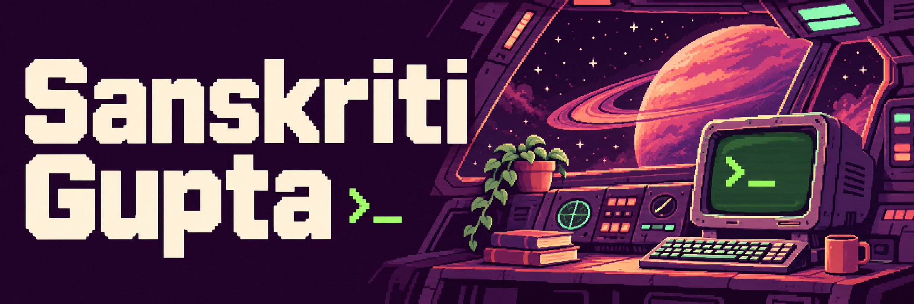

  <strong>Full-stack &amp; backend engineering</strong> 
  I build web apps and spend a questionable amount of time debugging them.

  <a href="https://sanskriti-codes.vercel.app/"><strong>Portfolio</strong></a>
  &nbsp;·&nbsp;
  <a href="https://www.linkedin.com/in/sanskriti49/"><strong>LinkedIn</strong></a>
   
  Open to software engineering opportunities

## Contribution arcade

  
<strong>Tech stack</strong> &nbsp; <code>cat stack.yml</code>

  - **Languages** — Java, JavaScript, TypeScript, Python
  - **Frontend** — React, Next.js, Tailwind CSS
  - **Backend & data** — Spring Boot, Node.js, Express, PostgreSQL, MongoDB, Redis
  - **Delivery** — Docker, GitHub Actions, Terraform

